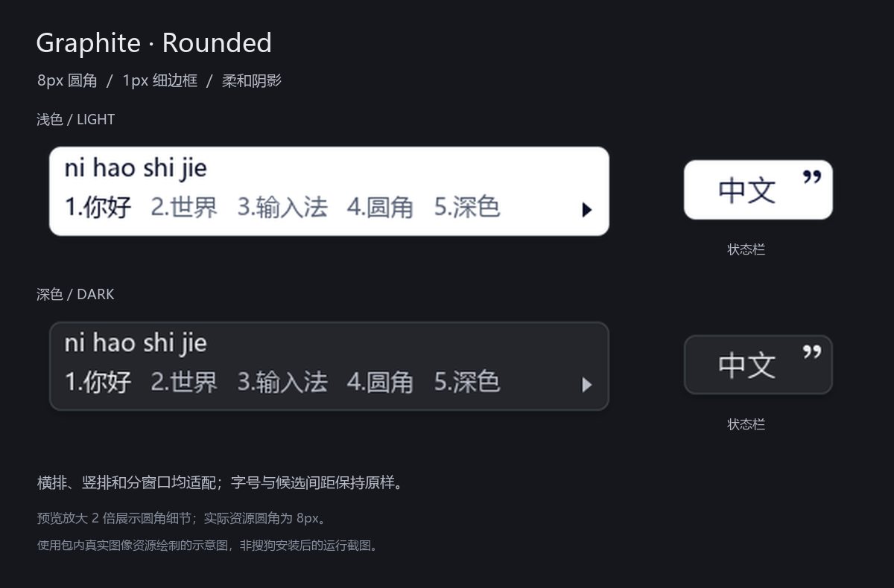

# Graphite Rounded — Windows 搜狗输入法圆角 / 深色皮肤

**这是给 Windows 搜狗拼音输入法使用的皮肤包，不是独立输入法程序。**

在 Graphite 石墨皮肤基础上加入 **8px 圆角、柔和阴影、浅色与深色配色**。下载后即可使用，不需要自己编译。

**快速入口：** [下载完整安装包](https://github.com/LappIand/sogou-graphite-rounded/releases/latest/download/Graphite-Rounded-Native-LightDark.zip) · [查看安装教程](docs/INSTALL.md) · [全部下载与版本](https://github.com/LappIand/sogou-graphite-rounded/releases/latest)

- 想用搜狗的“浅色 / 深色 / 跟随系统”开关：选择完整原生接入包，接入**经典默认皮肤槽位**。安装脚本会为**所有已存在的版本目录**同时打好补丁并分别备份，已验证 16.6.0.4777、16.10.0.6093/6125。
- 想直接双击安装单种配色：下载 [浅色 `.ssf`](https://github.com/LappIand/sogou-graphite-rounded/releases/latest/download/Graphite-Rounded-Light.ssf) 或 [深色 `.ssf`](https://github.com/LappIand/sogou-graphite-rounded/releases/latest/download/Graphite-Rounded-Dark.ssf)，两者为单主题皮肤。

> 本项目是 **Graphite 石墨皮肤的二次修改版本**，不是原创皮肤。
>
> **原设计作者：[xiaochunjimmy](https://github.com/xiaochunjimmy)（Jimmy Cheung / Remix Design）**  
> **Windows 移植作者：[jrfeng](https://github.com/jrfeng)**  
> 上游项目：[Remix-Design/Sogou-Input-Skin](https://github.com/Remix-Design/Sogou-Input-Skin)



## 改动

- 浅色、深色两套配色，候选窗与状态栏统一 **8px 圆角**。
- **1px 细边框**与按圆角轮廓重新生成的柔和阴影。
- 6 倍超采样抗锯齿。
- 修正横排、竖排与分窗口的固定切片，避免拉伸时圆角变形。
- 保留原字体、字号、候选间距、按钮位置及原作者字段。

预览放大两倍展示细节，是使用皮肤实际资源绘制的示意图，不是输入法运行截图。

## 下载与使用

在仓库 **Releases** 中下载完整原生接入包；也可从 `skins/` 下载普通单主题 `.ssf`。

### 原生浅色 / 深色 / 跟随系统

本项目把两套资源接入**经典默认皮肤槽位**，由搜狗自身的模式开关选择资源。它不是在一个普通第三方 `.ssf` 中添加未经验证的深色字段。

**搜狗升级后需重新执行一次 Install。** 升级会新建版本目录并放回自带原始资源；安装脚本会遍历所有版本目录、分别备份后统一替换，因此多版本并存也不会失效。

1. 解压 Release 中的原生接入包，或使用本仓库 `native/` 目录。
2. 在包含 `Manage-GraphiteNativeTheme.ps1` 的目录打开管理员 PowerShell。
3. 先执行只读检查，再显式安装：

```powershell
powershell.exe -NoProfile -ExecutionPolicy Bypass -File ".\Manage-GraphiteNativeTheme.ps1" -Action Check
powershell.exe -NoProfile -ExecutionPolicy Bypass -File ".\Manage-GraphiteNativeTheme.ps1" -Action Install
```

4. 在搜狗中选择**经典版默认皮肤**，通过“属性设置 → 外观 → 模式选择”使用浅色、深色或跟随系统。
5. 重开需要使用输入法的应用以刷新皮肤缓存。

脚本仅替换经典槽位的 `Skin.dat / SkinDark.dat`，先备份，并保留已存在的完整备份。潮流默认槽位、程序、DLL、词库和账户配置保持原样。

还原命令：

```powershell
powershell.exe -NoProfile -ExecutionPolicy Bypass -File ".\Manage-GraphiteNativeTheme.ps1" -Action Restore
```

详细步骤、备份位置和版本限制见 [安装说明](docs/INSTALL.md)。

### 普通单主题皮肤

- `skins/Graphite-Rounded-Light.ssf`：浅色圆角版。
- `skins/Graphite-Rounded-Dark.ssf`：深色圆角版。

双击对应 `.ssf` 安装。每个文件仅含一种配色；要使用搜狗原生模式切换，请采用上面的原生接入方式。

## 源码与验证

```sh
python -m pip install -r requirements.txt
python scripts/build.py
python scripts/package.py
```

构建只读取仓库内固定来源样本并写入仓库文件，不读取或修改搜狗安装目录。预览生成使用 Windows 微软雅黑；其他环境可指定 `GRAPHITE_FONT`，或只生成皮肤资源。

已完成：两套共 **120 组固定圆角拉伸检查**、资源与包校验，以及 **10 项安装/还原副本测试**。验证范围与复现方法见 [构建说明](docs/BUILD.md) 和 [验证说明](docs/VALIDATION.md)。

原生接入包尚未由本项目制作流程执行真实安装；实际候选窗效果、DPI 和版本兼容性仍需使用者验证。

## 署名与权利说明

原始视觉设计、Windows 移植、原始素材分别归属原作者。本项目的二次改动为圆角、深色配色、阴影、切片与安装/构建工具，不代表原作者背书。

上游未发现明确的 `LICENSE` 文件；本仓库保留上游署名与来源，不将原皮肤素材另行标为 MIT、Apache 等许可证。完整来源和署名证据见 [ATTRIBUTION.md](ATTRIBUTION.md)。
